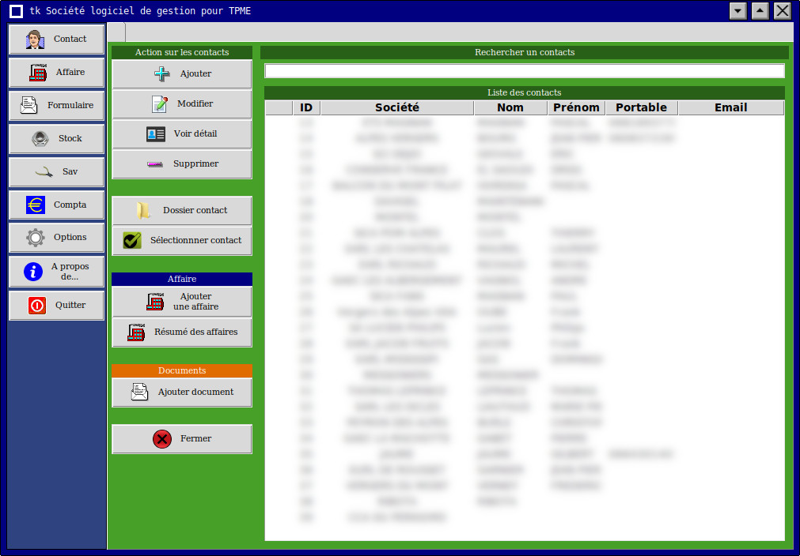
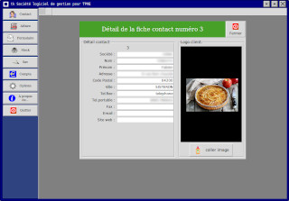
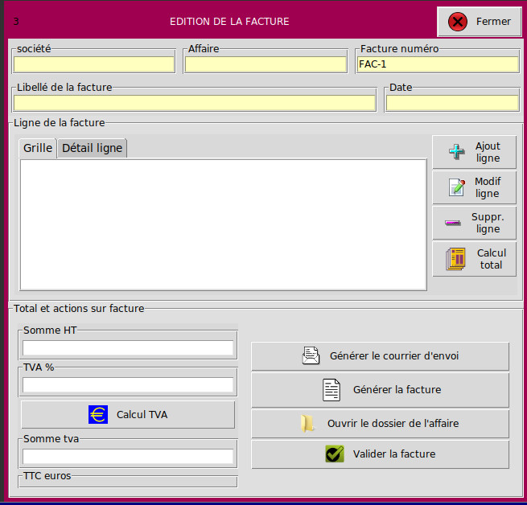

# tksociete

Développé depuis Janvier 2024, TKSociété est un logiciel pour gérer une TPME simplement à l'aide de modules à la façon d'intercalaires de couleur.

Ses modules sont :

    Un module CONTACT pour la gestion des contacts
    Un module AFFAIRE pour la gestion d'affaires (chantiers, constructions, etc...)
    Un module STOCK pour la gestion d'article (gestion des mouvements de stock, quantité, commande, etc...)
    Un module SAV pour la gestion des interventions SAV, et du parc machine.
    Un module FORMULAIRE pour la création de devis, facture, BL etc..
    Un module COMPTABILITE simple pour connaitre son chiffre d'affaire en temps réel.

    # Besoins
    Ce logiciel entièrement codé en tcl utilise :

    La bibliothèque TK pour l'interface
    le paquet tix et tktable (depots linux)
    Le paquet tkpng pour la gestion des images (en cours de suppression des dependances)
    L'interface sqlite3 pour les bases de données (paquet tcl8.x-tdbc-sqlite3)

A titre d'information, sur l'ordinateur ou je developpe ce logiciel, tksociete utilise des logiciels externes pour scanner un document, generer un pdf ou simplement naviguer sur le disque dur .

Vous avez la possiblite de modifier le nom de ces logiciels dans les options du programme, mais voici les programmes dont vous pourriez avoir besoin :

    Scanneur de documents : simple-scan
    Explorateur de fichiers : thunar
    Creation de document pdf a partir de fichier html : wkhtmltopdf
    Editeur html (modification des documents) : seamonkey

    # téléchargement
    [Télécharger la dernière version au format ZIP](https://github.com/FabienTon/tksociete/releases/latest/download/mon-projet.zip)

    # Avantages 
L'avantage de ce logiciel réside dans sa simplicité d'utilisation et son interraction entre les différents modules.

Les couleurs choisies permettent à l'utilisateur de retrouver facilement ses repères et de saisir ou trouver une information très rapidement.

Entièrement codé sous Linux, je ne l'ai pas essayé sous windows ou macintosh (Je vous laisse le soin de le tester et de me dire si il fonctionne)

# Exécution du logiciel 

. Pour l'exécuter il vous suffit de lancer un terminal dans le répertoire de l'application et d'écrire :

wish fmain.tk

ou de lancer le script depuis un terminal present dans le dossier de l'appilcation :

./run.sh

# Captures d'écran

